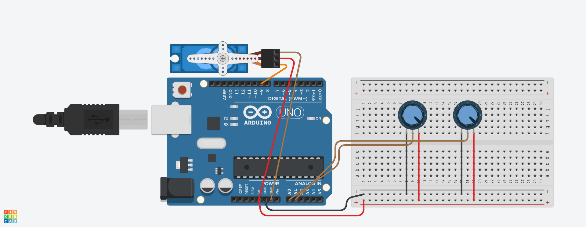

# Projeto 01 - Controle de Servo Motor com Arduino Uno

Projeto desenvolvido para a disciplina de **Sistemas Embarcados**, do curso de **Análise e Desenvolvimento de Sistemas**, com o objetivo de controlar o ângulo máximo de giro e a velocidade de movimentação de um servo motor utilizando dois potenciômetros e um Arduino Uno.

## Sobre o projeto

O projeto consiste em um sistema de controle de servo motor por meio de dois potenciômetros. Cada potenciômetro possui uma função específica, permitindo ajustar o comportamento do motor de maneira interativa.

O primeiro potenciômetro controla o ângulo máximo de giro do servo motor, enquanto o segundo permite ajustar a velocidade de movimentação da hélice.

O funcionamento é controlado por um Arduino Uno, responsável por ler os valores dos potenciômetros e controlar os movimentos do servo motor conforme os ajustes realizados.

## Componentes utilizados

- 1 Arduino Uno
- 1 servo motor
- 2 potenciômetros
- 1 protoboard
- Jumpers (fios de conexão)
- Cabo USB para conectar o Arduino ao computador

## Montagem do circuito

O circuito foi montado no Tinkercad, conectando os dois potenciômetros às entradas analógicas do Arduino Uno e o servo motor à saída correspondente.

Os potenciômetros permitem ajustar os parâmetros de funcionamento, enquanto o Arduino processa as leituras e controla a movimentação do servo motor.

## Funcionamento

- **Potenciômetro 1:** controla o ângulo máximo de giro do servo motor.
- **Potenciômetro 2:** controla a velocidade de movimentação da hélice.
- **Arduino Uno:** processa os valores recebidos e controla o servo motor em tempo real.

---

Projeto acadêmico desenvolvido com Arduino Uno e potenciômetros para demonstrar conceitos de programação, leitura de sinais analógicos e controle de atuadores em sistemas embarcados.
